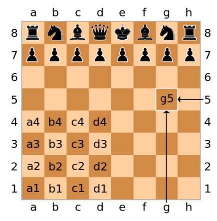

# Chess App

* 2-player chess application

  * Two players take turns on a single Command Line Interface (**CLI**)

* Moves are described in [algebraic notation](https://en.wikipedia.org/wiki/Algebraic_notation_(chess))
   - 1. e4 e5
   - 2. Nf3 Nc6
   - 3. d4

