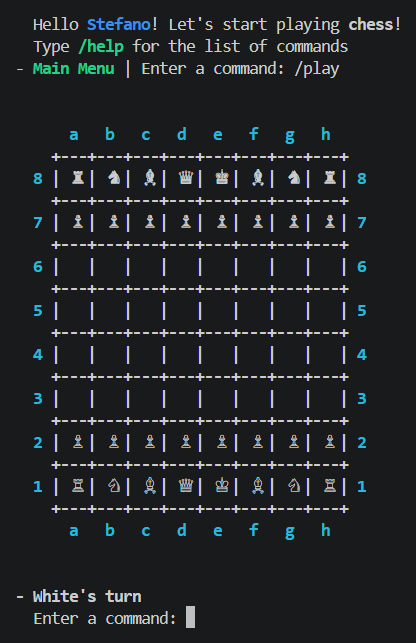
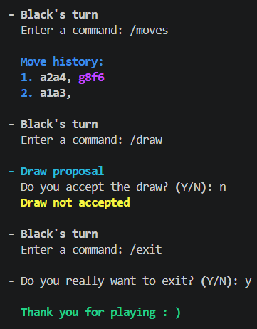
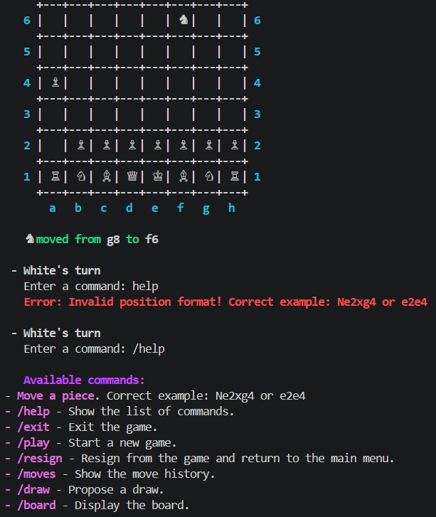
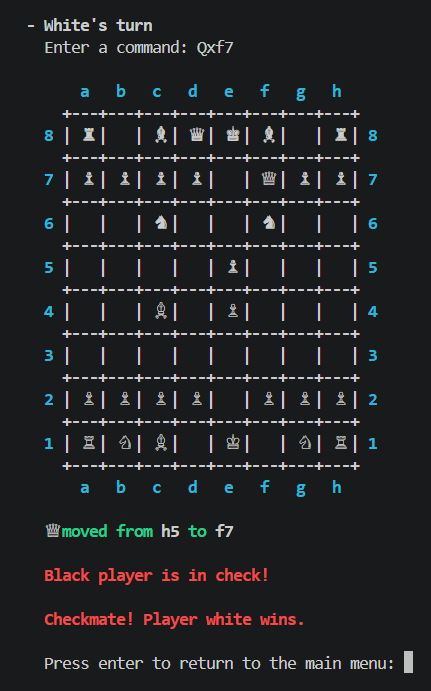

# User Manual

### Initial menu commands

When the application opens, the user can enter the following commands:
- /play: allows the user to start a new game. If a game is already in progress, the application will display the turn of the player who must make a move;
- /help or --help or -h: displays the available commands with a brief description for each;
- /exit: when activated, the system will ask for confirmation. If confirmed, the application will close and control will return to the operating system. If refused, the application will wait for new commands.

### Game
Once the user starts a game, the chessboard with all pieces will appear on screen. At the beginning of each game, the player with the white pieces goes first (in accordance with the official chess rules).
Subsequently, players take turns challenging each other until: a stalemate occurs, or one of the players wins the game, wants to resign, propose a draw, or exit the game. In all cases except exiting the game, the user will return to the main menu. In the case of exiting, as mentioned before, the application is fully closed.

#### Game commands
The following commands can be used by both users during the game:

- /board: shows the position of the pieces on the chessboard. It can be called at every turn to display the board with updated positions. This command can be used during the game, and if executed in the main menu, the application will suggest using the /play command first;
- /resign: if one of the players intends to resign from the game, they must use the appropriate command. The application will then ask for confirmation: if confirmed, the application will announce that the opponent wins by resignation. If refused, the application will wait for new attempts or commands;
- /draw: with this command, one of the players requests to end the game in a draw. The opponent's affirmative answer is required to confirm. If the opponent does not want to conclude, they will refuse the confirmation. The application will then wait for new attempts or commands;
- /moves: allows the user to display the moves made in algebraic notation. These only concern the current game. To make moves during the game, the user must enter two pairs of letter-number values (e.g.: e4, d5,...)
to define the position of the piece to move and the destination position (the application will confirm whether the move can be completed: if successful, the board will be displayed with updated piece positions; if unsuccessful, an error message will be shown and the application will wait for a valid move).
- /help: displays the list of available commands again (see Initial menu commands section);
- /exit: allows the user to exit the application during the game (see Initial menu commands section);

#### Pieces, movement, capture and check
Every move must be in Algebraic Notation. Inexperienced users are strongly advised to read [this guide](https://en.wikipedia.org/wiki/Algebraic_notation_(chess)) before starting.

Here are the possible moves for each piece type: 

- Pawn: pawns can move and capture in two different ways: they move forward, but capture diagonally. Pawns can only advance one square at a time, except for their first move where they can advance two squares. Pawns only capture on squares immediately in front of them, diagonally. They can never move backward or capture backward. If another piece is placed directly in front of a pawn, it can neither pass nor capture it. An important implementation for the pawn is known as "pawn promotion":
    - If a pawn reaches the eighth rank, it is promoted, meaning it takes on the role and movement capabilities of another piece of the same color (queen, rook, bishop, or knight) as specified by the player in algebraic notation. If no piece is specified, the pawn is automatically promoted to Queen. This way, it is possible to have more pieces of a given type than initially available.
- Queen: can move to squares that are horizontal, vertical, and diagonal from its position; capture occurs in the same positions as movement;
- Rook: can move to squares that are horizontal and vertical from its position; capture occurs in the same positions as movement;
- Bishop: can move to squares that are diagonal from its position; capture occurs in the same positions as movement;
- Knight: unlike other pieces, its movement follows an "L" shape, that is, two squares in one direction (horizontal or vertical) and then one square perpendicular to that direction. Capture can occur at positions where the knight can land back on the board;
- King: the King can move to squares immediately adjacent to it. Being the most important piece in the game, pay attention to the following points:
    - it cannot move to positions threatened by opponent pieces. To learn how to handle such situations, read the "Delivering check and checkmate" section;
    - it can capture in the same positions where it can move;
    - once per game, each king can use a special move known as castling, which consists of moving the king two squares toward the kingside rook (kingside castling) or the queenside rook (queenside castling), and then moving that rook to the square the king crossed. This can only be done if all the following conditions are met: The player has not yet moved either the king or the rook involved in castling; there are no pieces (friendly or opponent) between the king and the rook being used; the king's starting square, the square it crosses, and its destination square are not threatened by an opponent piece. To execute castling in the app, the user must enter: 0-0 for kingside castling, 0-0-0 for queenside castling.

#### Delivering check and checkmate

To deliver check to the King and checkmate, users must follow these instructions:
- The king is the only piece that can never be captured, only threatened. When it is threatened, meaning it is on the trajectory of an enemy piece, it is said to be "in check". This condition is communicated via a message, and a "+" symbol is added to the move that puts the opposing king in check in the move history, following algebraic notation rules. No move is allowed that places or leaves one's own king in check. To eliminate the threat, one of the following must be done:
    - move the king to one of the adjacent squares, provided it is not under the control of an opponent piece;
    - capture, with the king or another piece, the opponent piece that is on the king's trajectory and causes the check;
    - in the case of a threat from a queen, rook, or bishop not adjacent to the attacked king, interpose any piece or pawn between the king and the threatening piece, so that the interposing piece is threatened instead of the king.
    - If none of the moves the player can make are able to free the king from check, it is checkmate and the game ends with the opponent's victory;
    - If instead the king is not in check but no legal move can be made (for example, if only the king remains in play and it is not in check but all adjacent squares are threatened), it is stalemate and the game ends in a draw, as the player in this condition cannot move without breaking the rules of the game.
    - When an endgame condition is reached, a message is displayed. In case of checkmate, the winner's color is shown. In case of stalemate, a simple draw message is shown. After this, the user cannot use the main commands but must press enter to return to the main menu, where they can use the commands again, for example to start a new game or exit.
